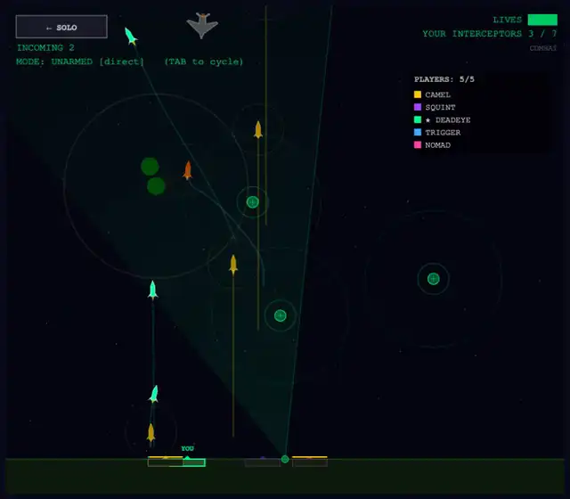
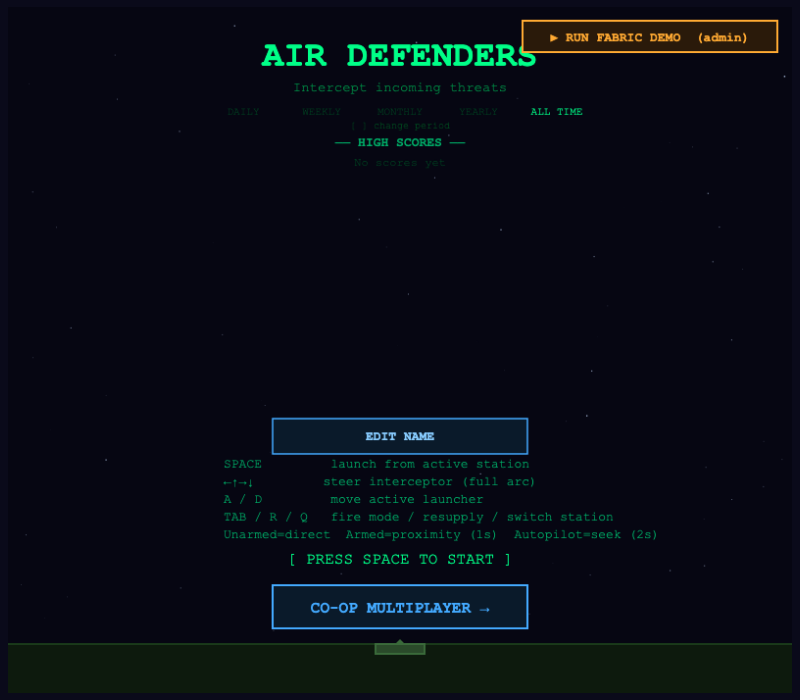
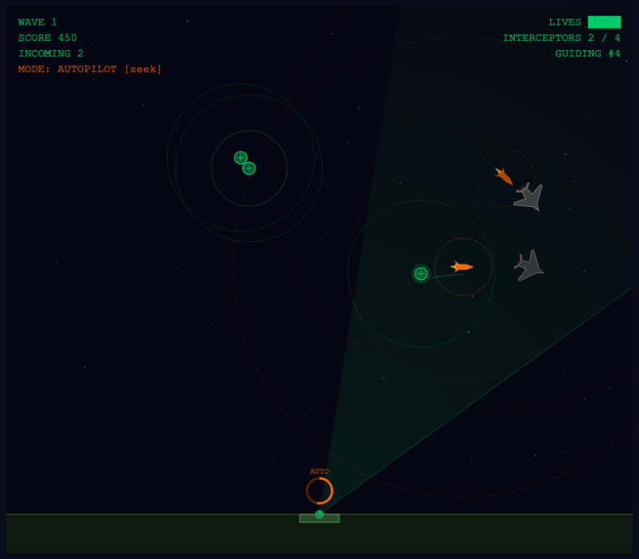
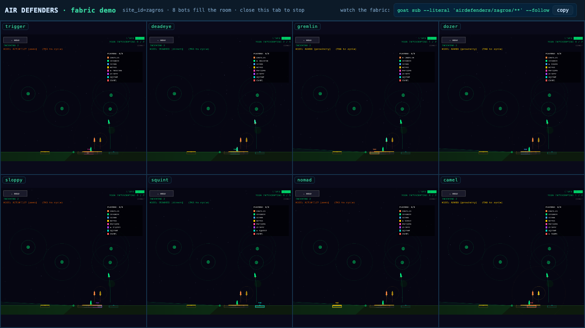

<h1 align="center">goatrodeo</h1>

<p align="center">
  
  <br>
  <sub>Air Defenders, co-op room, five auto-pilot bots on one laptop. Nobody is at the keyboard. They seem fine.</sub>
</p>

<p align="center">
  Games and toys that run on a goat data fabric: each one is fun to play and publishes real events while you play it.
</p>

<p align="center">
  <a href="LICENSE"></a>
</p>

Everything here sits beside [`goatcore`](https://github.com/usareur-af/goatcore), which builds the goatnet, and [`goatstuff`](https://github.com/usareur-af/goatstuff), which holds the inspection surfaces. None of it is needed to run a goatnet. That is rather the point.

## What is in here

| Thing | What it is | Runs on a laptop |
|---|---|---|
| [Air Defenders, solo](#air-defenders) | A browser arcade game: steer interceptors into incoming drones before they reach the ground | yes |
| [Air Defenders, co-op](#co-op) | The same game with up to eight players in one shared room | yes |
| [The eight bots](#the-eight-bots) | Auto-pilot players with different habits, so the room is busy even when you are not | yes |
| [The fabric demo](#the-fabric-demo) | All eight bots in one browser tab, built to be watched from the fabric side | the page, yes; the fabric side needs a goatnet |

All four are one small Go program with three web pages inside it. Every capture on this page was taken from it running on a laptop; [docs/media/CAPTURES.md](docs/media/CAPTURES.md) says how, so you can check our work or refresh a stale picture.

## Air Defenders

<p align="center">
  
  
</p>

Drones come in over a night sky. Radars only show you part of it. You have one launcher, a handful of interceptors and three ways to fire them: steered by hand, proximity-fused, or seeking on their own. When a wave ends, the sky shows the path of every shot, so you can see exactly where it went wrong. Later waves add a second launcher, a siren that sends you running for the bunker, and a relief wave in which camels handle the air defense by spitting. We did not make that last part up; it is in the code.

Run it:

```bash
cd ops/serve/airdefenders
DB_PATH=./local-scores.db AD_DEMO_UNGATED=1 SITE_ID=zagros go run .
```

Then open `http://localhost:8095/`. You need Go (the version in `go.mod`) and a browser; Go fetches two small libraries the first time. `DB_PATH` puts the high-score database in a local file, `AD_DEMO_UNGATED=1` opens the bot demo page without a sign-in, and `SITE_ID` is the name the game would publish under.

| Key | Does |
|---|---|
| Space | launch from the active launcher |
| Arrow keys | steer the interceptor in flight |
| A / D | move the launcher |
| Tab | change fire mode |
| R | resupply |

What it shows about the platform: one container, one process, one SQLite file. High scores are shared between everyone who can reach the server and arrive live over Server-Sent Events, and the browser keeps its own copy so the board still draws when the network is away. Design: [airdefenders-leaderboard.md](docs/design/airdefenders-leaderboard.md).

## Co-op

Press **CO-OP MULTIPLAYER** on the title screen, or open `http://localhost:8095/mp`. Up to eight players share one room, one score and one set of lives; each gets a launcher in their own color. The animation at the top of this page is this mode.

What it shows about the platform: the server owns the game. It steps the simulation 30 times a second and sends every browser a full snapshot; browsers send only key presses and draw what they are told. Four moments in that loop (a radar detection, a launch, an intercept, a drone reaching the ground) are also put on an in-process event bus, which is where the fabric comes in below. Design: [airdefenders-multiplayer.md](docs/design/airdefenders-multiplayer.md).

## The eight bots

Add `?bot=<name>` to the co-op address and that browser tab plays by itself: `http://localhost:8095/mp?bot=deadeye`. A bot reads the same snapshots a person sees and sends the same key presses, so the server cannot tell the two apart.

| Bot | Plays like |
|---|---|
| `trigger` | fires constantly, aims loosely, uses up the ammunition |
| `deadeye` | waits, lines up, steers by hand, rarely misses |
| `gremlin` | changes target and fire mode at random |
| `dozer` | slow to decide, slow to move, takes naps |
| `sloppy` | over-fires and switches targets a lot |
| `squint` | only shoots at what the radar can see |
| `nomad` | roams the whole field, firing as it goes |
| `camel` | holds the middle and calls in the camels |

They are eight settings of one small loop in `mp.html`, tuned so that between them they press every button in the game. On a Mac with Chrome, [`spawn-bots.sh`](ops/serve/airdefenders/spawn-bots.sh) opens one window per bot in a grid.

## The fabric demo

<p align="center">
  
</p>

With the server from above running, open `http://localhost:8095/demo`. Eight bots fill the room from a single tab and play until you close it.

What it shows about the platform: this page is a traffic generator with a scoreboard. On a goatnet, with the publisher switched on (`ZENOH_PUBLISH=1`), the four moments from the co-op loop are published onto the Zenoh fabric under `airdefenders/<site>/…`, and the command in the page header tails them:

| Key | Published when |
|---|---|
| `airdefenders/<site>/radar/detection/v1` | a radar sees a drone |
| `airdefenders/<site>/missile/fired/v1` | a launcher fires |
| `airdefenders/<site>/missile/intercept/v1` | an interceptor hits |
| `airdefenders/<site>/shahed/impact/v1` | a drone reaches the ground |

On a laptop the publisher is off and the game plays on its own, which is why there is no picture of events arriving here: that half needs a goatnet. The runbook for it is [airdefenders-zenoh-demo.md](docs/operations/airdefenders-zenoh-demo.md), and the event schemas are in [`ops/zenoh-trial-peers/airdefenders-schemas/`](ops/zenoh-trial-peers/airdefenders-schemas/).

## Run it on a goatnet

The role and playbooks in `ops/ansible/` deploy Air Defenders behind the goatnet's sign-in. They assume an assembled goatcore tree with this repository's `ops/` copied over it, the same way goatstuff's surfaces deploy. The image is built by `.github/workflows/airdefenders-image.yml` and published as `ghcr.io/usareur-af/airdefenders`.

It builds on base images named by role, `ops/base-images/<role>/Dockerfile` (`go-build`, `runtime-static`); the defaults are Chainguard's free images, pinned by digest. To build on your own, follow goatcore's [build goat images on your own base images](https://github.com/usareur-af/goatcore/blob/main/docs/operations/build-on-your-own-base-images.md). `ops/base-images/base-images.py` and the two role files are the same files as goatcore's.

## Add a game or a toy

Air Defenders is the pattern to copy:

| Put | Where |
|---|---|
| the service and its Dockerfile | `ops/serve/<name>/` |
| what it publishes: schemas, topic list | `ops/zenoh-trial-peers/<name>-schemas/` |
| the role and playbook that deploy it | `ops/ansible/` |
| how it works and how to run it | `docs/design/<name>.md`, `docs/operations/` |
| a test job | `.github/workflows/ci.yml` |
| captures, and how you made them | `docs/media/`, `docs/media/CAPTURES.md` |

Two house rules. It has to run on a laptop with the fabric switched off, so anyone can try it in a minute. And it has to publish something real when the fabric is on: a toy that only draws pictures belongs somewhere else. Then add a section to this page with a capture, because a fun thing nobody can see is not pulling its weight.

Before your first pull request, read [CONTRIBUTING.md](CONTRIBUTING.md); it is short. Report security issues privately, as [SECURITY.md](SECURITY.md) describes.

## License

`goatrodeo` was written by U.S. Federal government employees. In the U.S. it is not subject to copyright and is in the public domain; in countries where copyright is recognized, it is released under the [Apache License 2.0](LICENSE). See [INTENT.md](INTENT.md).

## Links

- [`goatcore`](https://github.com/usareur-af/goatcore): builds and runs a goatnet
- [`goatstuff`](https://github.com/usareur-af/goatstuff): the inspection surfaces you would watch these games from
- [`goatdocs`](https://github.com/usareur-af/goatdocs): the explanatory documentation
